# EventXplore: Expo & Exhibition Booking Platform

> Full-stack platform for running real trade shows in Thailand: public event pages, free visitor registration with QR tickets, paid exhibitor booth booking on a live hall map, sponsor packages, slip-based payment review, and three separate backoffice apps for the Owner, Sales team and on-site Ticket Checkers.

**Live:** [eventxplore.com](https://eventxplore.com) · first production event: [Thailand Coff&Mat Fest 2026](https://thailandcoffmatfest.com)
**Role:** Sole developer (product, UX, frontend, backend, database, DevOps, QA), Aug to Nov 2026
**Source:** private client codebase. This repo is a case study: architecture, module breakdown, screenshots and selected code excerpts.

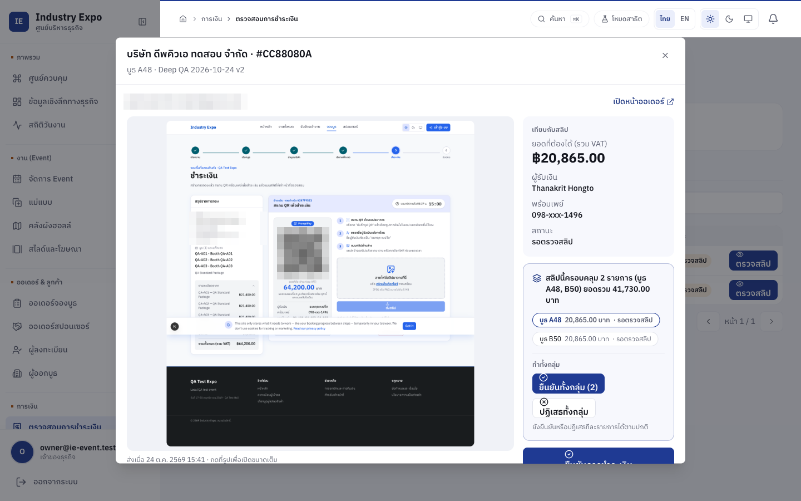

---

## At a glance

| Area | Detail |
|---|---|
| **Stack** | Next.js 16 (App Router, Server Actions) · React 19 · TypeScript · Tailwind CSS 4 · PostgreSQL 16 · PostgREST · Zod · Vitest · Playwright |
| **Codebase** | ~137k lines of TypeScript in 1,224 files · 153 pages · 20 API routes · 296 components · 68 domain modules |
| **Database** | 74 tables · 85 SQL migrations · 15 PL/pgSQL functions & triggers (state-machine guards, atomic checkout, hall sync) |
| **Tests** | 178 test files · ~1,600 unit/integration cases · 768 scripted manual QA cases (public / admin / ops) |
| **History** | 458 commits, 1 author, Aug 2 to Nov 6 2026 |
| **Hosting** | Self-hosted on a VPS (pm2 + Caddy), CI/CD via GitHub Actions with zero-downtime release switching and auto-rollback |

---

## The problem

Thai expo organisers usually juggle spreadsheets, LINE chats and bank-transfer screenshots to sell booths. The client wanted one system where:

- exhibitors pick a booth from the **real hall plan**, choose a package and add-ons, pay, and get a ticket without calling anyone;
- visitors register for free and receive a **QR ticket** that staff scan at the door;
- the Owner sees revenue, booth occupancy, funnel and check-in **in real time**, and controls every public channel with a switch;
- every baht is traceable: prices re-derived on the server, payments that can never go backwards, and a full audit log.

## Who uses it

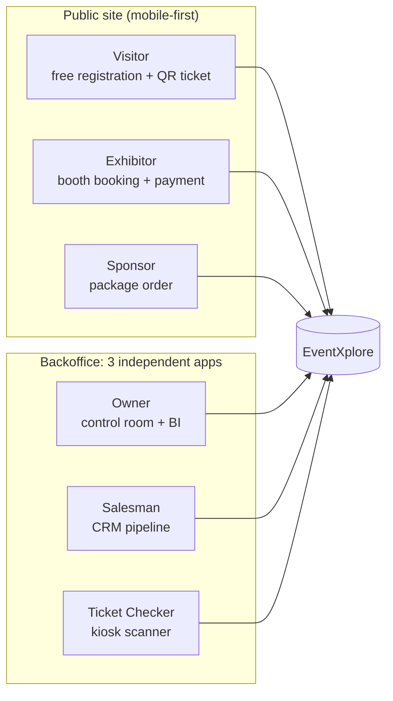

---

## Module breakdown

Each module has its own write-up in [`docs/`](docs):

| # | Module | What it covers |
|---|---|---|
| 1 | [Public site & booking flows](docs/01-public-booking-flows.md) | Event pages, 6-step exhibitor checkout with booth hold timer, visitor OTP login & group registration, sponsor flow, PDPA consent |
| 2 | [Hall Builder](docs/02-hall-builder.md) | Drag/resize canvas editor, zones and booth codes, real-world scale, draft/publish/history, templates, public hall map |
| 3 | [Payments & slip review](docs/03-payments-slip-review.md) | Provider-agnostic payment layer, PromptPay EMV QR generator, slip upload, QR decoding, duplicate detection, group approval |
| 4 | [Owner backoffice & BI](docs/04-owner-backoffice-bi.md) | Configuration Center switches, business dashboard with filter/compare, reports & Excel export, audit log |
| 5 | [Sales CRM](docs/05-sales-crm.md) | Salesman app: Kanban pipeline, tasks/notes, custom stages, performance leaderboard, invites |
| 6 | [Staff check-in](docs/06-staff-checkin.md) | Camera QR scanner, manual lookup, check-in locks, add-on redemption, event-day live stats |
| 7 | [Auth, RBAC & security](docs/07-auth-rbac-security.md) | Self-hosted auth, 3 path-scoped sessions, 4 roles / 29 permissions, rate limits, capability tokens, Turnstile |
| 8 | [Data model](docs/08-data-model.md) | ERD of the core tables, DB-level state guards, migration strategy |
| 9 | [Infrastructure & DevOps](docs/09-infrastructure-devops.md) | Vercel + Supabase Cloud to Railway to self-hosted VPS, release/rollback script, backups |
| 10 | [Quality & QA process](docs/10-quality-qa.md) | Unit tests, scripted QA suites, evidence screenshots, design system rules |

---

## Architecture

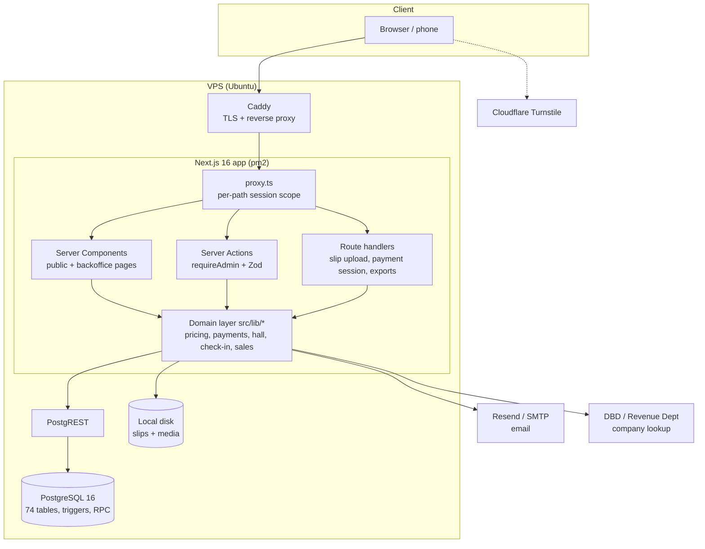

Key decisions:

- **Server is the only authority.** Event IDs, booth IDs, prices, totals and statuses from the client are never trusted; every Server Action re-resolves scope and permission.
- **Logic lives in `src/lib/*`, not in pages.** 68 domain modules with their own tests; UI was fully redesigned twice without touching pricing or payment logic.
- **Invariants enforced twice.** TypeScript guards in the app and PL/pgSQL triggers in Postgres (a `paid` payment can never regress, even via raw SQL).
- **Honest UI.** No fake numbers: when a metric has no real data source the tile says so. Disabled payment methods show as "coming soon", never faked.

---

## Screenshots

> Captured from the scripted Deep-QA run on 24 Oct 2026 (test data, pre-rebrand "Industry Expo" theme). Personal data and live QR codes are blurred.

| Public event (mobile) | Visitor registration (mobile) |
|---|---|
| 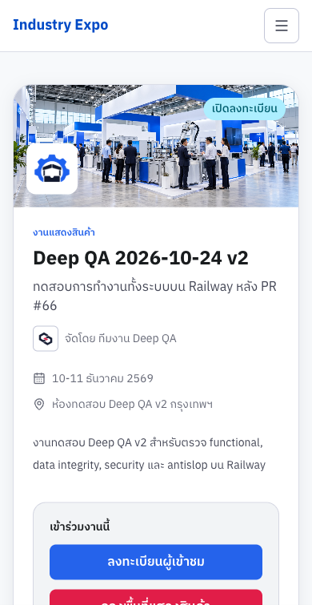 | 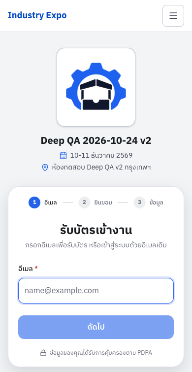 |

**Exhibitor booth picker:** live availability per booth, zone filter, multi-select, running total
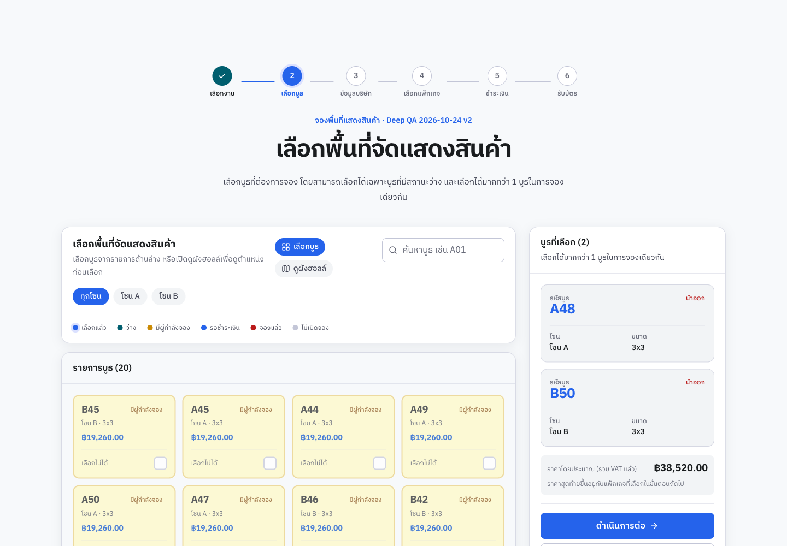

**Package & add-ons:** server-computed price breakdown with VAT
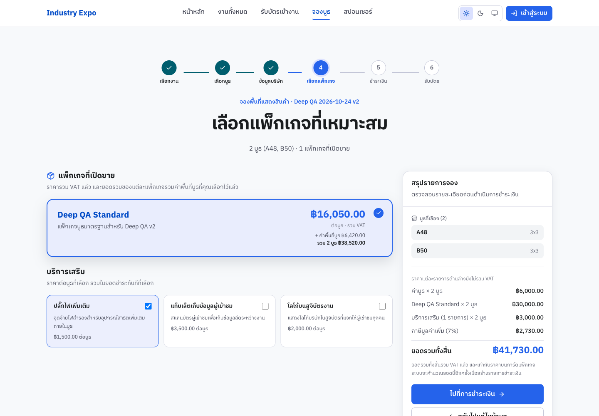

**Checkout review:** booth hold countdown, payment method switch (card shown as "coming soon")
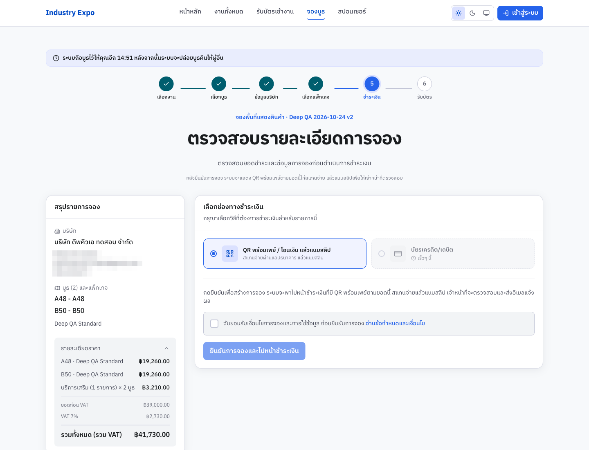

**Owner Control Center**
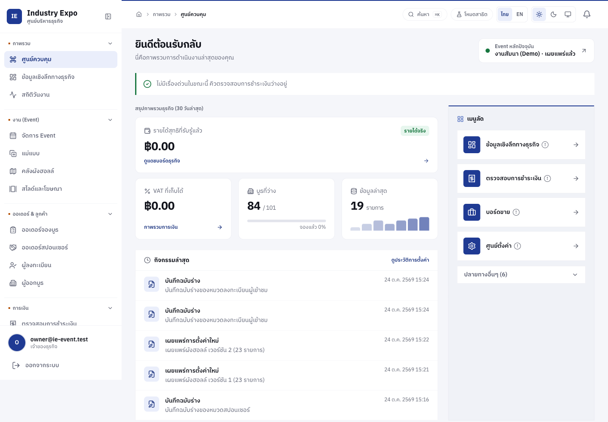

**Business dashboard:** filters by event and period
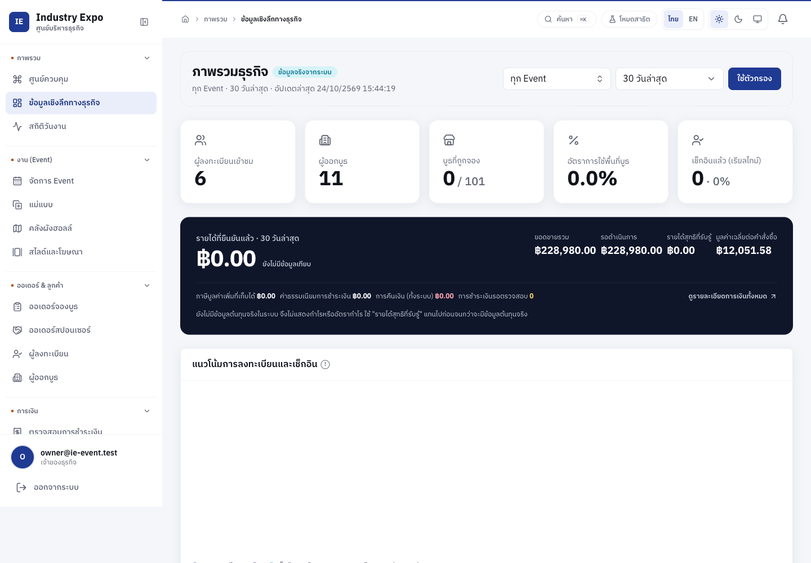

**Hall Builder:** zones, booths, entrances, stage, scale and snap-to-grid
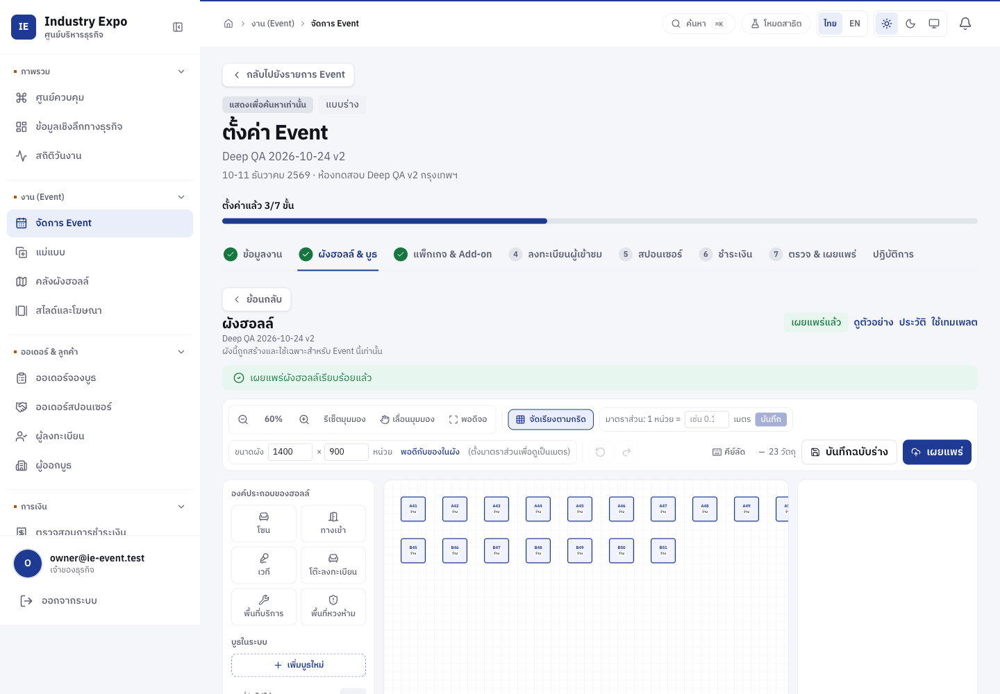

**Reports with Excel/CSV export**
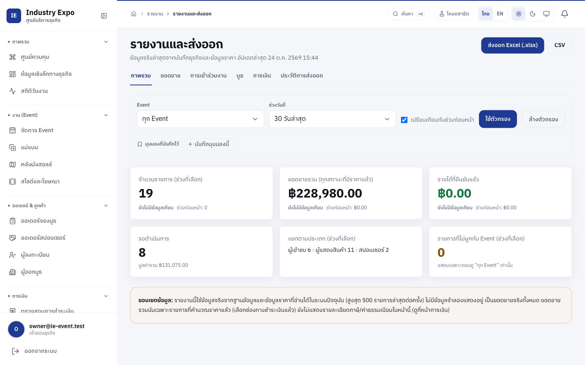

**Event-day operations**
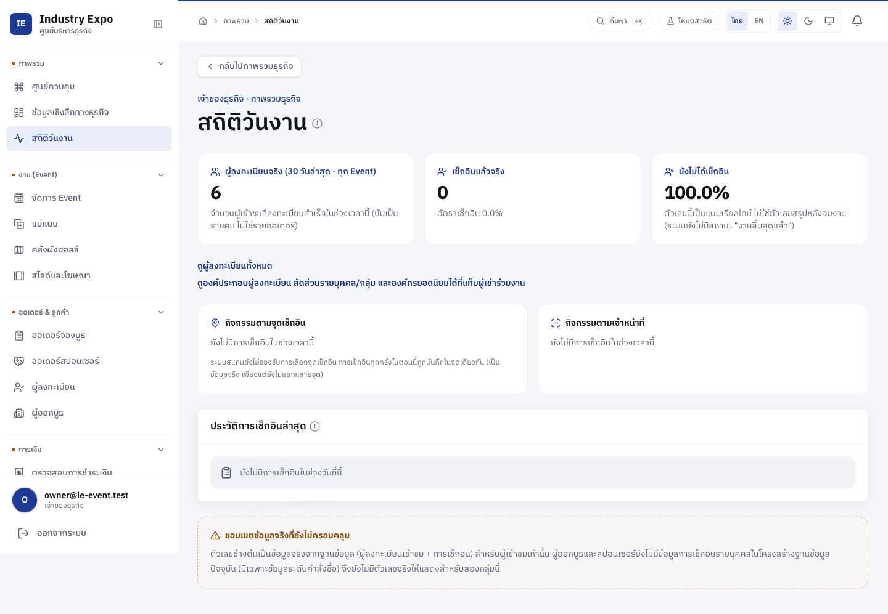

**Ticket Checker login** (separate app and session from the Owner)
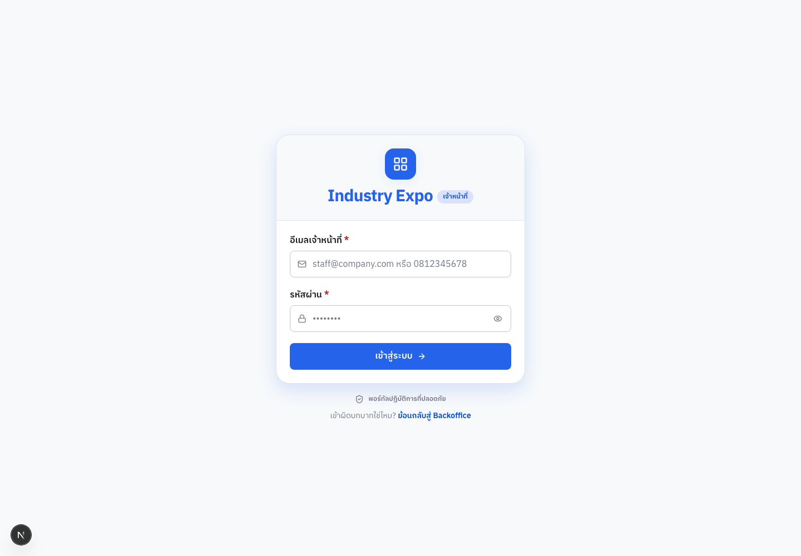

---

## Engineering highlights

- **Atomic group checkout in Postgres.** One RPC locks every order and booth booking `FOR UPDATE` in a fixed order, validates the whole group, moves the states and returns which booths could not be aligned. No partial confirmation, no deadlocks. [code](code-samples/confirm_exhibitor_checkout_group.sql)
- **PromptPay QR from scratch.** EMVCo TLV builder with CRC16/CCITT-FALSE that checks itself against the standard test vector, then re-parses its own output before showing it to a payer. [code](code-samples/promptpay-qr.ts)
- **Slip fraud screening.** SHA-256 file hash, reused transaction reference and reused QR payload are checked across every slip in the system. [code](code-samples/slip-duplicate-detection.ts)
- **Terminal payment states.** Explicit transition table in TS plus a matching DB trigger: `paid`, `failed`, `expired`, `cancelled` can never change again. [code](code-samples/payment-status.ts)
- **Thai Tax ID validation.** Accepts Thai and Arabic-Indic numerals, mod-11 checksum, masking helper shared by every admin screen. Audited and rejected an npm package that silently called a government SOAP API. [code](code-samples/thai-tax-id.ts)
- **Built for 100+ booth halls.** Multi-select, align/distribute, duplicate and bulk delete with undo/redo in the Hall Builder; anonymous 2-phase booth holds (HttpOnly hold token + expiry) release abandoned carts automatically.
- **Zero-downtime deploys.** Each release builds in its own folder next to the live one; DB backup + migrations, symlink switch, health check, and automatic switch-back on failure.

## Timeline

| Period | Milestone |
|---|---|
| Aug 2026 | Clickable prototype, domain model, payment & slip foundations (mock providers) |
| Sep 2026 | Real PostgreSQL schema, RBAC, Hall Builder, move from Vercel + Supabase Cloud to Railway with self-hosted Postgres/PostgREST/GoTrue |
| Oct 2026 | Sales CRM, check-in, BI dashboard, 768-case QA suites, full backoffice UI redesign (3 role-specific shells) |
| Nov 2026 | EventXplore rebrand, Coff&Mat Fest public theme, legal pages (TH/EN), VPS deploy with CI/CD, go-live |

---

### สรุปภาษาไทย

EventXplore คือระบบบริหารงานแสดงสินค้าครบวงจร พัฒนาคนเดียวทั้งระบบ (ส.ค.–พ.ย. 2569) ตั้งแต่หน้าเว็บสาธารณะ ระบบลงทะเบียนผู้เข้าชมพร้อมบัตร QR ระบบจองบูธบนผังฮอลล์จริงพร้อมชำระเงินด้วยการแนบสลิป ระบบสปอนเซอร์ ไปจนถึงหลังบ้าน 3 แอปแยกกัน (เจ้าของงาน / เซลส์ / เจ้าหน้าที่หน้างาน) พร้อมแดชบอร์ดธุรกิจ รายงาน และ audit log ใช้งานจริงกับงาน Thailand Coff&Mat Fest 2026

Repo นี้เป็น case study (ซอร์สโค้ดหลักเป็นของลูกค้า เก็บแบบ private)
