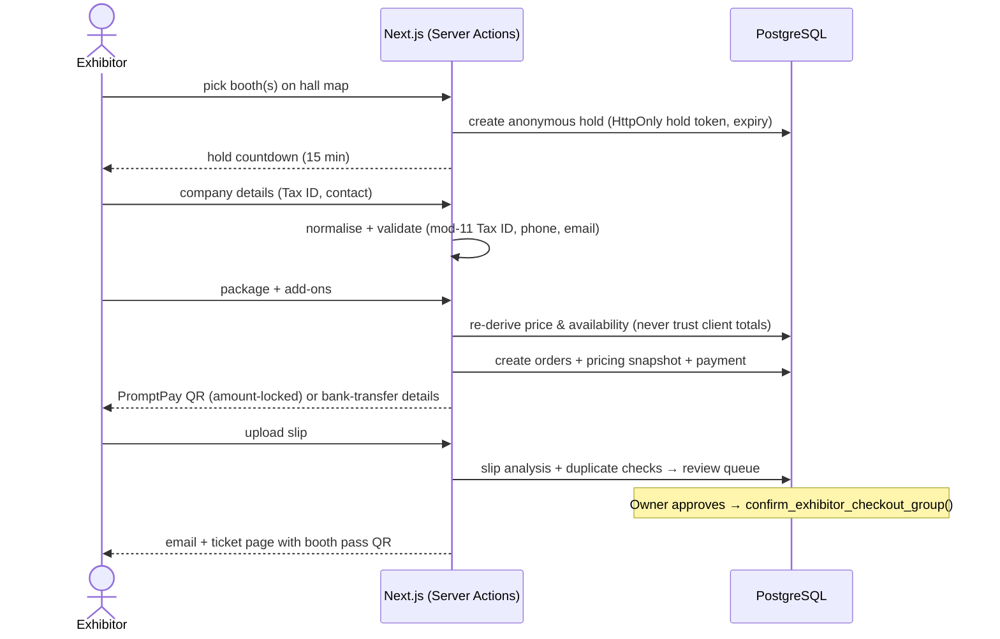

# 1. Public site & booking flows

[← Back to overview](../README.md)

The public site is mobile-first, Thai-first (with an English toggle), and every channel (visitor registration, exhibitor booking, sponsor intake) has its **own open/closed state**. Publishing an event page never silently opens booking or payment.

## Routes

| Area | Pages |
|---|---|
| Discovery | `/` · `/events` · `/events/[slug]` |
| Visitor | `/visitor/register` · `/visitor/confirm` · `/visitor/ticket/[code]` · `/visitor/me` (my tickets, profile) · `/visitor/addon/[orderId]` |
| Exhibitor | `/exhibitor/start` → `booths` → `company` → `packages` → `payment` → `ticket/[orderId]` |
| Sponsor | `/sponsor` → `/sponsor/[orderId]/review` → `success` |
| Legal | `/terms` · `/privacy` · `/cancellation-refund` (TH/EN) · cookie notice |
| Utility | `/company-lookup` · `/verify-email` · `/contact` |

## Exhibitor checkout (paid)

- **6-step progress tracker** with a live hold timer; an expired hold releases the booth for others.
- **Multi-booth orders** are one checkout group; one slip can cover the whole group.
- **Pricing snapshots** freeze the computed price at order time (booth fee + package + add-ons × booths + VAT 7%), shown before and after VAT.
- **Company lookup** pre-fills company data from the DBD / Revenue Department registries (provider-pluggable, mock in dev).
- **Resume link**: an exhibitor can leave and come back to an in-progress payment through a 256-bit capability token, never by guessable ID.

## Visitor registration (always free)

- Email-first flow: email → consent (PDPA) → details. Returning visitors log in with an **email OTP** and see all their tickets in `/visitor/me`.
- **Group registration**: one registrant can add several attendees, each with their own QR ticket.
- Ticket resend with rate limiting, paid visitor add-ons (separate slip flow) on top of the free ticket.

## Sponsor flow

Package catalogue per event, order review, payment handoff and success page; switchable per event from the Configuration Center.

## Rules the UI follows

- Never clear valid input after a validation error; field-level errors, focus and scroll to the first invalid field; server validates again.
- Whole hall always visible: available, held, awaiting payment, booked and not-for-sale booths each have a colour, never just a "sold out" message. VIP guest reservations look exactly like "booked" publicly.
- Draft data never reaches public pages; public pages read published data only.

Screenshots: [event (mobile)](../screenshots/01-public-event-mobile.png) · [registration](../screenshots/02-visitor-register-mobile.png) · [booth picker](../screenshots/03-exhibitor-booth-picker.png) · [packages](../screenshots/04-exhibitor-package-addons.png) · [checkout](../screenshots/05-exhibitor-checkout-review.png)
