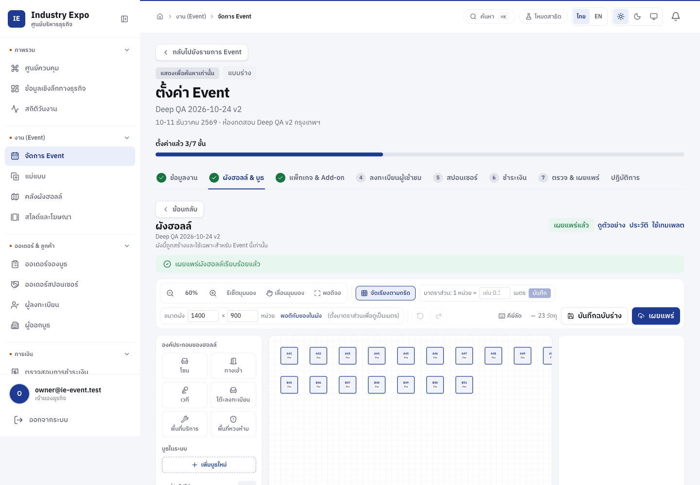

# 2. Hall Builder

[← Back to overview](../README.md)

The Owner draws the real exhibition floor once; the same data powers the public booth picker, the staff floor plan and the booth reports.

## Editor features

- **Canvas editor**: drag, resize, zoom (with fit-to-screen), snap-to-grid, keyboard shortcuts, **undo/redo**.
- **Object palette**: booths, zones, entrances, stage, registration desk, service areas, restricted areas, free shapes with colour/style panel and z-order.
- **Multi-select tools** for 100+ booth halls: align (6 modes), distribute (x/y), duplicate-drag, bulk delete.
- **Booth codes** generated by zone + sequence with collision checks; size, price, status and details per booth.
- **Real-world scale**: canvas units ↔ metres stated explicitly (e.g. 1 unit = 0.1 m), configurable canvas size.
- **Draft → Preview → Publish**, history with rollback, unsaved-change warning.
- **Templates & library**: start a new event from a saved layout.

## How it is stored

| Table | Purpose |
|---|---|
| `hall_layouts` | one layout per event, versioned |
| `hall_layout_objects` | every shape/booth on the canvas |
| `hall_layout_canvas`, `hall_layout_scale` | canvas size & unit-to-metre scale |
| `booths` | sellable inventory (code, zone, size, price, status) |
| `booth_holds`, `booth_bookings`, `booth_guest_reservations` | anonymous holds, bookings, private VIP reservations |

- `sync_hall_layout_objects()` (PL/pgSQL) publishes the canvas and the booth inventory **atomically**, so the public map and the sellable booths can never disagree.
- `hall_layout_fingerprint()` detects whether a draft actually differs from what is published.

## Public view

Booth status colours are shared tokens across the app: available (green), held (amber), awaiting payment (steel), booked (ink), not for sale (dashed grey), "your pick" (signal yellow). Exhibitors can use a simple card/list view first, with the real plan as an optional view.
