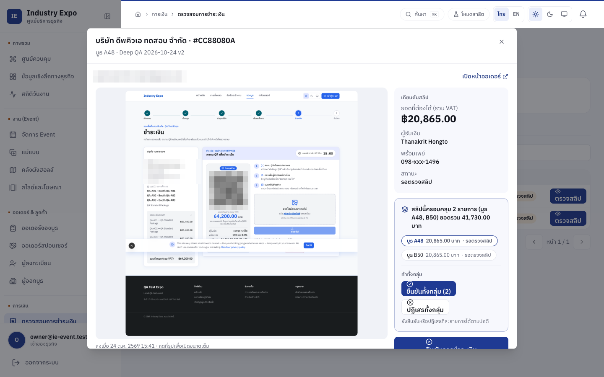

# 3. Payments & slip review

[← Back to overview](../README.md)



## Design: architecture now, phased rollout

The payment layer is a real multi-provider architecture (`PaymentProvider` interface, provider registry, webhook event store), but only the method the client could operate safely is switched on:

| Method | Status |
|---|---|
| PromptPay QR (amount-locked) + slip upload | **Live** |
| Bank transfer without PromptPay + slip upload | **Live** |
| Card (Stripe adapter) | Built behind a switch, shown as "coming soon" |
| Other gateways | Visible in Configuration Center, disabled |

```
src/lib/payments/
  payment-provider.ts      interface app code depends on
  provider-registry.ts     resolves active provider (fails closed)
  payment-status.ts        allowed transitions; paid is terminal
  money.ts                 integer minor units (satang), never float baht
  vat.ts                   VAT 7% helpers
  promptpay-qr.ts          EMVCo PromptPay payload + CRC16 self-check
  payment-accounts-service receiving accounts per event (with/without PromptPay)
src/lib/slip-analysis/     QR decode (jsQR + jimp), duplicate detection, risk scoring
src/lib/payment-review/    review queue, approve/reject, group actions
```

## PromptPay QR

Built from the EMVCo spec, not a library: tag-length-value fields, mobile or 13-digit ID proxy, THB amount, CRC16/CCITT-FALSE. Before a payload is shown to a payer it (1) verifies the CRC implementation against the standard test vector and (2) re-parses its own output and checks every field. Each event picks its own receiving account; an account without PromptPay switches the checkout to bank-transfer mode instead of falling back to someone else's QR. → [code](../code-samples/promptpay-qr.ts)

## Slip screening (honest scope)

- **QR decode** of whatever QR is on the slip; when it is a standard EMV payload, amount/reference are compared to the server-side payment record.
- **Duplicate detection** across all payments: same file (SHA-256), same transaction reference, same QR payload. → [code](../code-samples/slip-duplicate-detection.ts)
- **Deterministic risk score** with explained warnings. No "AI verified" claim: final approval is always a human reviewer, and the docs state exactly what QR decoding can and cannot prove.

## Review queue

- Owner/staff queue with filters per method (PromptPay, bank transfer, card, visitor add-ons), refunds and export history.
- **Group approval**: one slip that covers several booths can be approved or rejected as a group; the DB function locks all rows and confirms atomically. → [code](../code-samples/confirm_exhibitor_checkout_group.sql)
- Customer emails on approve/reject, email delivery history per order.

## Safety rails

- Payment status machine in TypeScript **and** a Postgres trigger (`payments_guard_status_transition`). → [code](../code-samples/payment-status.ts)
- Public slip upload/status reads are authorised by a 256-bit capability token, rate limited, origin checked, size/pixel limited.
- Amounts are always recomputed server-side from the pricing snapshot.
