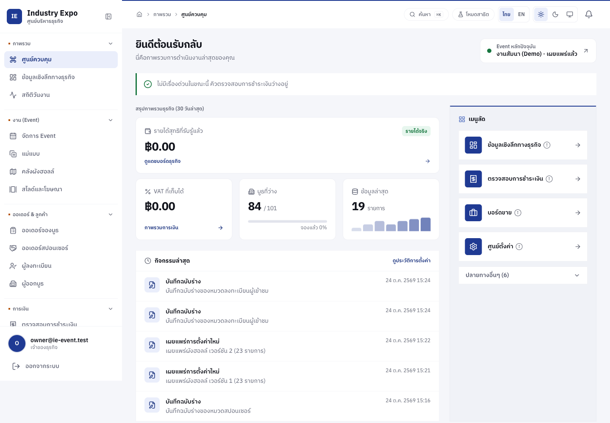
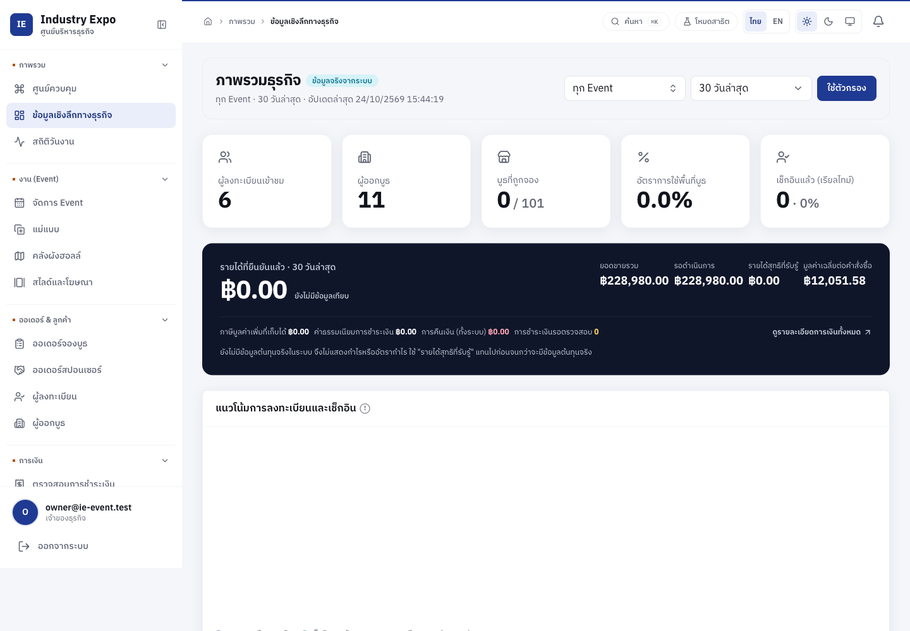
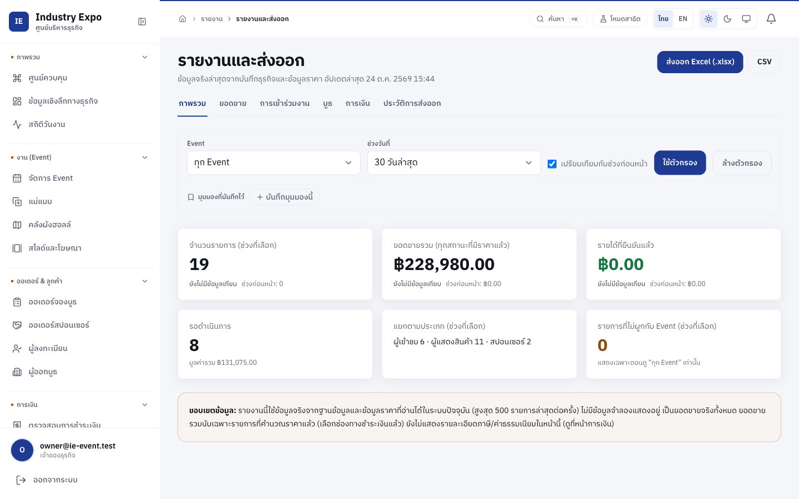

# 4. Owner backoffice & Business Intelligence

[← Back to overview](../README.md)

The Owner app is a control room: ~100 pages grouped by business category (Overview, Events, Orders & Customers, Finance, Reports, Settings), each behind server-side permission checks.

## Configuration Center: switch-first control

Every module with a real on/off state is a single iOS-style switch: optimistic UI update, server re-check, toast on failure.

- Groups: Event identity & public page, Visitor registration, Exhibitor booking & booths, Sponsor, Hall layout, Payments & payout methods, Notifications, Terms/PDPA, Promotions & slides, Roles & access.
- Each row shows the plain-Thai label, current state, the consequence of flipping it, and an explicit **Global vs. this Event** scope label.
- Master switches dim (not hide) their children, so no setting ever "disappears".
- Every change is written to `configuration_change_log` with actor and timestamp.

## Event setup wizard

Guided 7-step setup per event (info → hall & booths → packages & add-ons → visitor registration → sponsor → payment → review & publish) with a progress bar, preview of every public page, and publish separated from opening each channel.

## Business dashboard

- Global filter bar (event, period, channel, salesman) that persists across tabs; **compare mode** (this period vs. previous, event vs. event).
- Lenses: revenue by category/package, registration & booth funnel, sales performance, event-day operations, booth occupancy by zone, provinces, attention queue, recent activity.
- KPI tiles drill down to the filtered record list.
- **No invented numbers**: a metric without a real data source says so instead of showing a placeholder.

## Business data & finance

- Exhibitor orders, sponsor orders, visitor registrations: list, detail, and manual "create on behalf of" flows for sales-assisted deals.
- Finance per event: revenue summary, tax (VAT) summary, payment fees, refunds.
- Payment accounts per event (with or without PromptPay), refund requests.

## Reports & export

Overview, sales, attendance, booths and finance reports with saved views, period comparison, and **Excel (.xlsx via ExcelJS) / CSV export**, plus an export history log.

## Content & marketing

Landing page and per-event page builder (sections, partners, cover images with slide preview), promotional slides and ad slots, email/message templates, notification settings.

## Audit

`admin_audit_logs`, `business_audit_events`, `payment_audit_logs`, `slip_audit_logs`, `event_catalog_change_log`: every mutation records actor, event scope, action and time, viewable in `/admin/audit` and per event.
