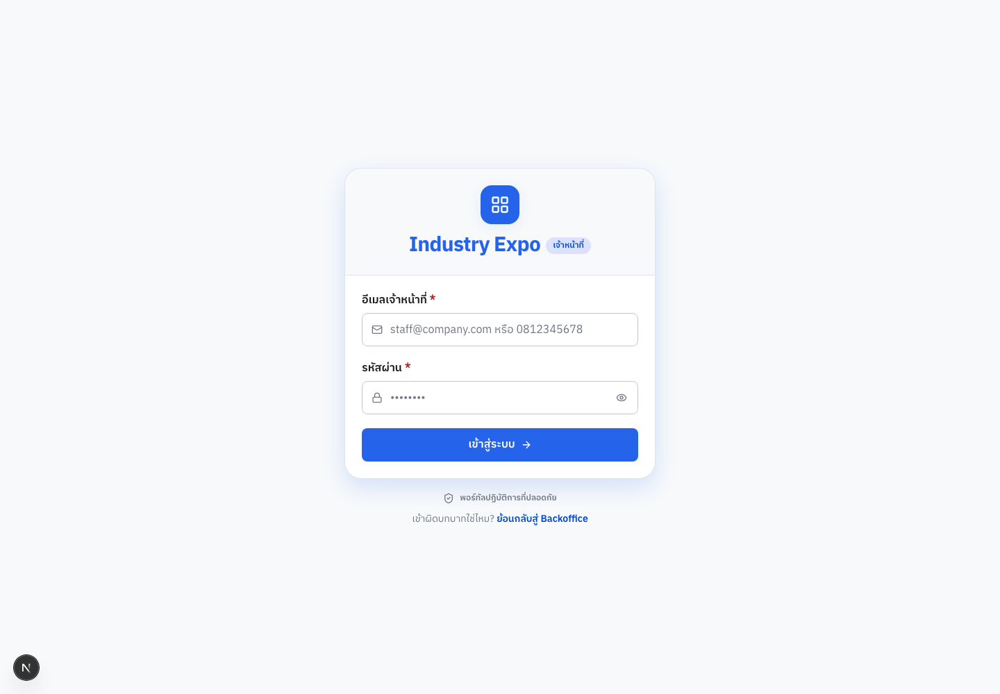
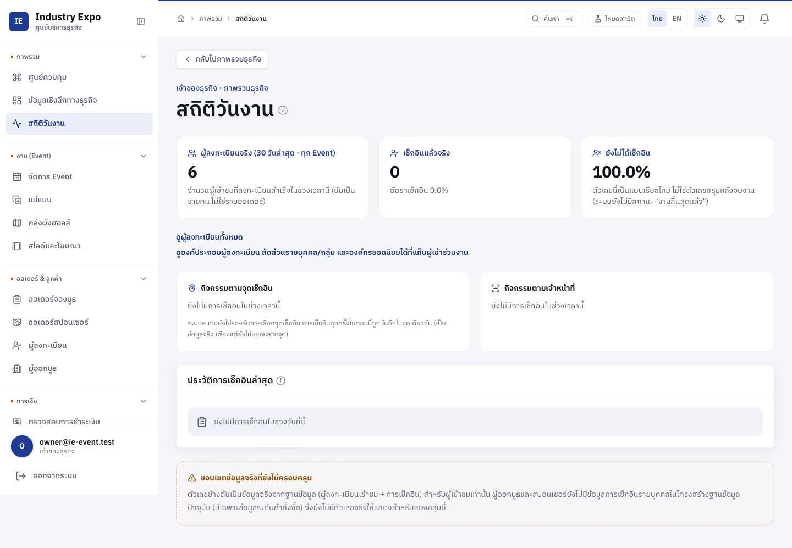

# 6. Staff check-in (Ticket Checker app)

[← Back to overview](../README.md)

Kiosk-density app at `/staff`, built for a phone or tablet in a noisy hall: one or two giant actions per screen.

## Features

- **Camera QR scanner** (getUserMedia + jsQR) and manual code entry.
- **Ticket search** by name, email or phone for visitors who lost their QR.
- **Clear outcomes**: checked in, already checked in (with time), wrong event, not found. Check-in is idempotent (unique index, one row per attendee).
- **Exhibitor booth passes** (`order_check_ins`) checked in the same way as visitor tickets.
- **Add-on redemption** at the door through `redeem_event_addon()`, which locks the row so a voucher can be used only once even with two scanners.
- **Floor plan** view for directing visitors.
- **Event scoping**: a checker only sees the events they are assigned to.

## Event-day dashboard (Owner)

Live registered vs. checked-in, no-show rate, check-in activity by point and by staff, recent check-in history.

## Recovery

Staff who lose access recover through an OTP challenge (`recovery_otp_challenges`), with audit of every session scope change.
