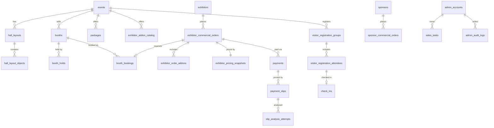

# 8. Data model

[← Back to overview](../README.md)

PostgreSQL 16 is the single source of truth: **74 tables, 85 migrations (~5,300 lines of SQL), 15 functions/triggers**. The app talks to it through PostgREST with one service role; authorisation is enforced in the application layer and, for money and attendance, again in the database.

## Core entities (simplified)

## Table groups

| Domain | Tables |
|---|---|
| Events & content | `events`, `event_channel_settings`, `event_content_sections`, `event_content_configuration`, `event_landing_partners`, `promotional_slides`, `media_files` |
| Hall & booths | `hall_layouts`, `hall_layout_objects`, `hall_layout_canvas`, `hall_layout_scale`, `event_floor_plans`, `booths`, `booth_holds`, `booth_bookings`, `booth_guest_reservations`, `booth_package_offers` |
| Exhibitor commerce | `exhibitors`, `exhibitor_commercial_orders`, `exhibitor_order_addons`, `exhibitor_order_slips`, `exhibitor_pricing_snapshots`, `packages`, `exhibitor_addon_catalog` |
| Visitors | `visitors`, `visitor_members`, `visitor_registration_groups`, `visitor_registration_attendees`, `visitor_login_challenges`, `visitor_ticket_resends`, `visitor_addon_orders`, `tickets` |
| Sponsors | `sponsors`, `sponsor_commercial_orders`, `sponsor_pricing_snapshots` |
| Payments | `payments`, `payment_slips`, `slip_analysis_attempts`, `payment_accounts`, `payment_method_settings`, `payment_webhook_events`, `refund_requests` |
| Operations | `check_ins`, `order_check_ins`, `event_addon_catalog`, `event_addon_redemptions` |
| Sales | `sales_tasks`, `sales_task_events`, `sales_task_notes`, `sales_custom_stages` |
| Accounts & audit | `admin_accounts`, `admin_account_invites`, `admin_password_resets`, `admin_audit_logs`, `business_audit_events`, `payment_audit_logs`, `slip_audit_logs`, `configuration_change_log`, `email_logs` |

## Database-level guards

| Function / trigger | Guarantees |
|---|---|
| `payments_guard_status_transition` | a terminal payment (`paid`, `failed`, …) never changes again |
| `payment_slips_guard_status_transition` | slip review states move forward only |
| `booth_bookings_guard_status_transition` | booking lifecycle cannot skip or regress |
| `exhibitor/sponsor_commercial_orders_guard_granting_state` | order "granting" state machine |
| `visitor_registration_attendees_guard_qr_state` | a ticket's QR state is consistent with check-in |
| `confirm_exhibitor_checkout_group(uuid[])` | atomic multi-booth confirmation with ordered `FOR UPDATE` locks → [code](../code-samples/confirm_exhibitor_checkout_group.sql) |
| `redeem_event_addon` | single-use voucher redemption under concurrency |
| `sync_hall_layout_objects`, `hall_layout_fingerprint` | atomic hall publish, draft change detection |

## Money

All amounts are stored as **integer minor units** (satang). Every order keeps a **pricing snapshot** (booth fee, package, add-ons, VAT, totals before/after VAT) so later price edits never change what a customer agreed to.

## Migrations

Plain numbered SQL files replayed in order (`0000` creates the service role and stubs so the original Supabase-era files replay unchanged on vanilla Postgres). The deploy script backs up the database before applying any new migration.
