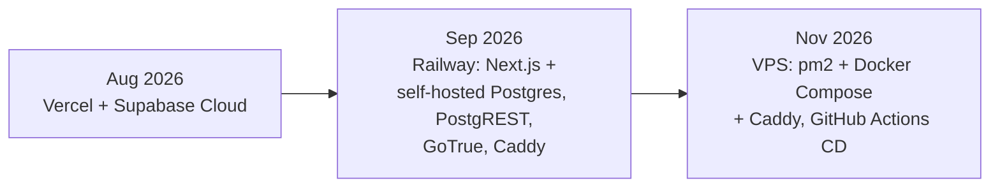

# 9. Infrastructure & DevOps

[← Back to overview](../README.md)

## Hosting journey

Why move: Supabase Cloud free tier pauses after a week of inactivity (unsafe for a production event), and the client wanted full ownership of data and cost.

## Production layout

| Piece | How |
|---|---|
| App | Next.js production build run by **pm2**, one folder per release |
| Database | Postgres 16 + PostgREST in Docker Compose, bound to `127.0.0.1` only (Docker bypasses ufw) |
| Edge | **Caddy** for TLS and reverse proxy, two domains (eventxplore.com, thailandcoffmatfest.com) |
| Files | Uploaded slips and media on a shared folder that survives releases |
| Email | Resend or SMTP (Nodemailer), console provider in dev; delivery log per message |

## CI/CD

GitHub Actions: on pull request → `tsc --noEmit`, ESLint, Vitest. On merge to `main` → same checks, then SSH deploy.

`deploy-release.sh`:

1. Build the new release in `releases/<time>-<sha>/` next to the live one (a failed build never touches the live site).
2. If there are new migrations: **back up the DB**, then apply them.
3. Switch the `current` symlink, restart pm2.
4. Health check on the app port; on failure, **switch back automatically**.
5. Keep the last N releases, so rollback is pointing `current` at the previous folder.

## Operations scripts

- `backup-db.sh`: daily cron + pre-migration, custom-format dumps, rotation.
- `event-readiness.sh`: read-only health and capacity report before a busy event day.
- `switch-to-final-domains.sh`: domain cut-over.
- Provisioning scripts for the first Owner account and staff invites; seed scripts for demo events.

## Local development

`docker compose up` (Postgres, PostgREST, GoTrue, Caddy) + `bootstrap-local-db.sh` to replay migrations + `npm run dev` on port 4242. Feature flags (`PAYMENT_PROVIDER=mock`, `EMAIL_PROVIDER=console`, `COMPANY_LOOKUP_PROVIDER=mock`) keep dev fully offline.
